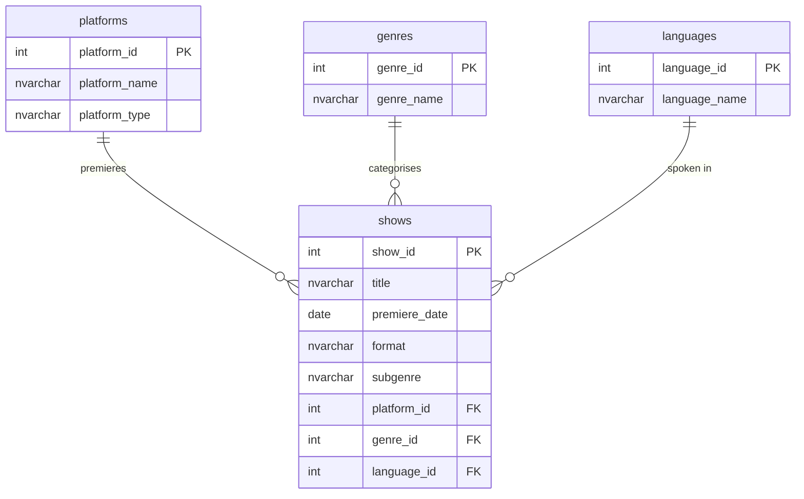

# New TV Shows of 2026: SQL Server Database & Analysis

A SQL Server project analysing 70 new TV series that premiered between January and October 2026 across streaming services, cable and broadcast networks. Raw research data is loaded into a staging table, validated, normalised into a relational database, and analysed to compare how platforms are launching new shows.

**Skills shown:** data collection and research · relational database design · ETL from a staging table · data validation · T-SQL joins, CTEs, conditional aggregation and window functions (`RANK`, `ROW_NUMBER`, `LAG`, running totals)

## Project structure

```
tv-shows-2026/
├── data/
│   └── tv_shows_2026.csv         # Raw research data (one row per show)
└── sql/
    ├── 01_create_tables.sql      # Database, staging table and normalised tables
    ├── 02_load_staging.sql       # Loads the raw data into staging
    ├── 03_transform_and_load.sql # Cleans, validates and loads the normalised tables
    └── 04_analysis_queries.sql   # 12 analysis queries
```

## Database design



`CHECK` constraints limit `format` to Scripted, Animation, Docuseries or Reality, limit `platform_type` to Streaming, Broadcast, Basic cable or Premium cable, and require every premiere date to fall in 2026.

## Questions answered

| # | Question | Techniques |
|---|---|---|
| 1 | Which platforms launched the most new shows? | `RANK()`, window percentage |
| 2 | Streaming vs traditional TV | `COUNT(DISTINCT)` |
| 3 | Premieres per month, with a running total | CTE, `SUM() OVER` |
| 4 | Quarter-over-quarter change | `LAG()` |
| 5 | Format mix by platform | Pivot with `SUM(CASE …)` |
| 6 | Most popular genres | Window percentage |
| 7 | Each platform's top genre | `RANK() OVER (PARTITION BY …)` |
| 8 | Share of non-English shows by platform | Conditional aggregation |
| 9 | Most common premiere weekday | `DATENAME` |
| 10 | Release cadence per platform | `LAG()` partitioned, `DATEDIFF` |
| 11 | Each platform's first and latest new show | `ROW_NUMBER()`, self-join |
| 12 | Shows that premiered on the same day | Self-join |

## Key findings

These describe the 70 shows in this dataset (see the data notes below).

- **Streaming dominates:** 60 of the 70 new shows (86%) premiered on streaming services.
- **Netflix launched the most,** with 22 new shows (31%), followed by Apple TV and Prime Video with 13 each.
- **Netflix also had the fastest release pace,** averaging a new show every 12 days.
- **Comedy was the most common genre** (17 shows, 24%), followed by thriller (11).
- **Wednesday was the most popular premiere day,** with 28 of the 70 shows (40%), well ahead of Friday (16).
- **8 shows were not in English,** including Norwegian, Portuguese, Japanese, Swedish, French, German, Italian and Spanish series.

## How to run

1. Install **SQL Server Express** (free) and **SQL Server Management Studio (SSMS)**.
2. In SSMS, open and run each script in the `sql` folder in order: `01` → `02` → `03`.
3. Open `04_analysis_queries.sql`, highlight a query and press **F5** to see its results.

Requires SQL Server 2017 or later (for `TRIM`).

## Data notes

- **Sources:** premiere dates, platforms and genres were collected from Wikipedia's lists of original programming for each service (Netflix, Prime Video, Apple TV, HBO, HBO Max, Hulu and Disney+), with selected dates checked against network announcements and news coverage.
- **This is a sample, not a census.** The 70 shows are a selection of new series, so counts reflect this dataset rather than every show released in 2026. In particular, monthly and quarterly totals depend on which shows were selected.
- Only brand-new series are included; new seasons of returning shows are excluded.
- `premiere_date` is the series premiere in its home market. Each show has one primary genre, with a more specific `subgenre` kept for detail.
