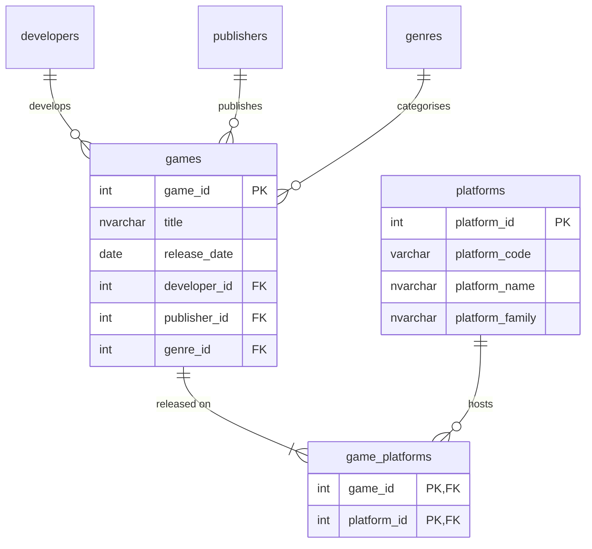

# Video Games of 2023: SQL Server Database & Analysis

A SQL Server project that takes a flat spreadsheet of 40 notable video games released in 2023, cleans and migrates it into a normalised relational database, and answers business questions about release timing, platform strategy and publishers.

**Skills shown:** relational database design · normalisation · ETL from a staging table · data cleansing and validation · T-SQL joins, CTEs, aggregation and window functions (`RANK`, `ROW_NUMBER`, `LAG`, running totals)

## Project structure

```
video-games-2023/
├── data/
│   └── games_2023.csv            # Original flat spreadsheet (one row per game)
└── sql/
    ├── 01_create_tables.sql      # Database, staging table, normalised tables, platform lookup
    ├── 02_load_staging.sql       # Loads the raw spreadsheet rows into staging
    ├── 03_transform_and_load.sql # Cleans, validates and loads the normalised tables
    └── 04_analysis_queries.sql   # 12 analysis queries
```

## Database design

The spreadsheet stored everything in one sheet, with all of a game's platforms in a single comma-separated cell (for example `PS5, XSX, PC`). The ETL step splits that into a proper many-to-many relationship.



Constraints enforce data quality at the database level: unique titles, foreign keys on every relationship, and a `CHECK` that every release date falls in 2023.

## ETL and data quality

`03_transform_and_load.sql`:
1. Trims stray whitespace from every text column
2. Runs data-quality checks (duplicates, missing values, invalid dates, unknown platform codes), which should all return 0
3. Loads the developer, publisher and genre lookup tables
4. Loads games with their foreign keys
5. Splits the platform list with `STRING_SPLIT` into one row per game and platform
6. Reconciles row counts: 40 staging rows → 40 games and 126 game–platform links

## Questions answered

| # | Question | Techniques |
|---|---|---|
| 1–2 | Releases per month, with a running total | `GROUP BY`, `SUM() OVER` |
| 3 | Games per platform and share of all releases | Joins, subquery |
| 4–5 | Exclusives vs multi-platform releases | CTE, `CASE`, `HAVING` |
| 6 | Games released on PlayStation, Xbox *and* Nintendo | `COUNT(DISTINCT)` |
| 7 | Publishers ranked by output | `RANK()` |
| 8 | Self-published games | Self-comparison across joins |
| 9 | Most common genres and their platform reach | CTE, `AVG` |
| 10 | Busiest month for each platform family | `RANK() OVER (PARTITION BY …)` |
| 11 | Longest gaps between releases | `LAG()`, `DATEDIFF` |
| 12 | Releases by quarter | `DATEPART`, window percentage |

## Key findings

- **PC was the most supported platform:** 33 of the 40 games (82.5%) released on PC, ahead of Xbox Series X|S (28) and PlayStation 5 (26).
- **October was the busiest month,** with 8 releases, and Q4 had the most releases of any quarter (32.5% of the year).
- **10 games were single-platform exclusives:** 5 on Nintendo Switch (all published by Nintendo), 3 on PC and 2 on PlayStation 5.
- **Only 6 games launched across all three console families** (PlayStation, Xbox and Nintendo), including Hogwarts Legacy and Mortal Kombat 1.
- **Nintendo was the top publisher** with 5 games, and 9 games were self-published by their own studio.
- **Action RPG and action-adventure** were the most common genres, with 6 games each.

## How to run

1. Install **SQL Server Express** (free) and **SQL Server Management Studio (SSMS)**.
2. In SSMS, open and run each script in the `sql` folder in order: `01` → `02` → `03`.
3. Open `04_analysis_queries.sql`, highlight a query and press **F5** to see its results.

Requires SQL Server 2017 or later (for `TRIM` and `STRING_SPLIT`).

## Data notes

- The dataset is a curated selection of 40 notable 2023 releases, not every game released that year.
- `release_date` is each game's first release on any platform. Platforms are those the game launched on during 2023.
- Each game is given one primary genre.
